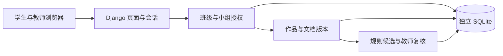

# 02 架构与环境约束讨论稿

日期：2026-11-12。架构决策当前为提议。首版验收场景和真实 AI 的时点见[启动评审](01_启动评审.md)。

## 运行环境和部署边界

| 项目 | 首版约束或提议 | 验证方式 |
| --- | --- | --- |
| 操作系统与终端 | 已确认本机演示。建议以当前 Windows 11 / PowerShell 为参考，用本机浏览器访问回环地址。 | 从干净检出复跑安装、迁移、预置数据和本机启动；记录系统和工具实测版本。 |
| Python 与依赖 | 建议 Python 3.13、Django 5.2、uv 和 Ruff。智能审查系统单独维护 `.python-version`、`pyproject.toml` 和 `uv.lock`，环境以实际锁文件为准。 | S1 冻结依赖后验证 Django 检查、迁移一致性、测试、Lint。当前机器已验证 Python 3.13.15、uv 0.12.16；Django 5.2.17 为现有市场工程实测版本。 |
| 数据与配置 | 建议使用项目目录内独立 SQLite，提交物使用虚构种子数据，排除本地库和密钥。首版无需外网或模型密钥即可运行；首次依赖安装需要可用缓存或包源。 | 测试使用独立测试数据库；验证不会读取市场平台数据库，也不会调用模型服务。 |
| 原型 | 现有 HTML/JS 可独立演示；其检查脚本已用 Node.js 24.22.1 运行。 | Node.js 当前仅用于原型检查，不作为后端运行依赖。 |
| 上限 | 文件大小、并发和响应时间尚无验收目标。 | 上传阶段确认技术限制；首版演示通过不代表可共享部署或满足生产负载。 |

## 架构决策提议

| 编号 | 推荐及备选 | 取舍、验证与复评条件 |
| --- | --- | --- |
| ADR-01 应用结构 | 独立 Django 单体，服务端模板和会话登录；备选为前后端分离。 | 本机演示用一套启动流程。班级授权、文档版本、审查复核在单体内分责，避免重复鉴权。需要外部客户端时重新评估。 |
| ADR-02 数据与归属 | SQLite + Django ORM；班级归属沿小组和作品关系推导，避免重复存放可矛盾的班级字段。备选 PostgreSQL。 | 在本机验证唯一性、外键及授权隔离；共享部署或出现写入争用时复评数据库与任务执行方式。 |
| ADR-03 审查执行 | 每次上传校验通过并保存版本后，系统自动启动该版本的本地规则审查，保存执行结果和失败状态。具体执行方式待 S3 评审。 | 固定样本可重复执行。测试首版和修订版上传后自动触发，以及规则失败后保留对应文档版本。 |
| ADR-04 工程控制台（后续提议） | 仅在本机测试配置中启用，授权给指定测试管理员。直接配置学生账号和班组关系走控制台入口，代操作则使用目标账号身份进入既有业务页面。 | 按当前有效身份校验每项业务操作。测试审计同时记录真实管理员、目标账号、操作与结果。 |

## S1 接口与数据草案

S1 使用虚构账号验证完整建班和入班流程。班级成员记录关联教学班和学生，在同一班内唯一。分组前，班级成员的小组为空。分组后，成员的小组须与教学班一致。每班一名主审教师，每个学生在同一班最多一组，每组本次任务最多一份作品。

| 接口职责 | 输入与响应 | 权限和验收 |
| --- | --- | --- |
| 创建教学班 | 课程、学期和班级标识。成功后显示班级与系统生成的随机邀请码。 | 教师登录后创建，由会话身份确定主审教师。不同教学班的邀请码唯一。 |
| 凭码加入教学班 | 学生输入邀请码。成功后班级出现在学生列表中，教师名单显示该生待分组。 | 检查学生身份和邀请码。入班只建立班级成员关系，作品访问从正式分组起生效。重复提交保持同一成员记录。 |
| 查看教学班 | 会话身份；返回用户可访问的班级。 | 教师只看到负责班级；学生只看到自己所属班级。用两个教学班验证隔离。 |
| 查看教师班级总览 | 班级 ID；返回所有小组、是否提交和已有版本摘要。 | 仅负责教师可进入；未提交组有状态行。待复核和待核实计数由 S3 提供，在没有审查数据时不得伪报已复核。 |
| 创建小组（设计提议） | 班级 ID 和组名。成功后小组出现在本班分组列表。 | 仅负责教师可创建。同班组名唯一。 |
| 给本班学生分组 | 班级、学生和目标组 ID。保存后显示最新分组。 | 服务端校验教师、学生、目标组的班级归属。原组已提交则拒绝迁出，目标组已提交则拒绝加入，拒绝时保留原成员关系。锁定检查与更新放在同一事务内。 |
| 查看作品 | 作品 ID；从作品查其小组和教学班，再决定是否返回。 | 本组学生和负责教师可读；同班其他组学生、其他班教师以及未登录者无法读取。直接输入其他组的作品 ID 也须拒绝。 |

跨阶段约束：权限在服务端按目标对象的实际归属校验；后续原文、版本、候选和复核记录沿用同一边界。文档版本和原复核决定保留；候选与教师决定分开记录。模型阶段将上传文本视为待审数据，外部服务未经确认前不发送文档。

工程控制台设计草案把两类操作区分开。直接配置可为测试学生创建账号，并省略邀请码建立班级成员记录，分组仍校验班级归属和提交后的锁组规则。进入代操作后，页面显示当前目标账号并提供退出入口。班级权限、作品访问和复核权限均以目标账号为准，测试管理员的控制台权限只在退出代操作后恢复。测试记录保留真实操作者和目标账号。

Django 与 SQLite 的取舍见 ADR-01/02。ADR-03 的执行方式随 S3 的输入边界和规则用例评审。
